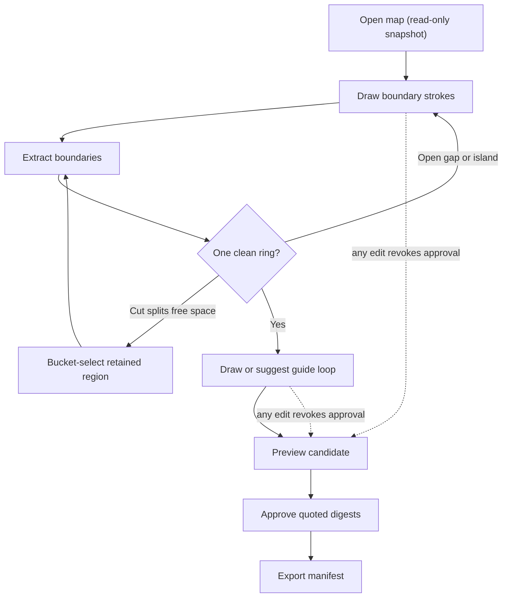
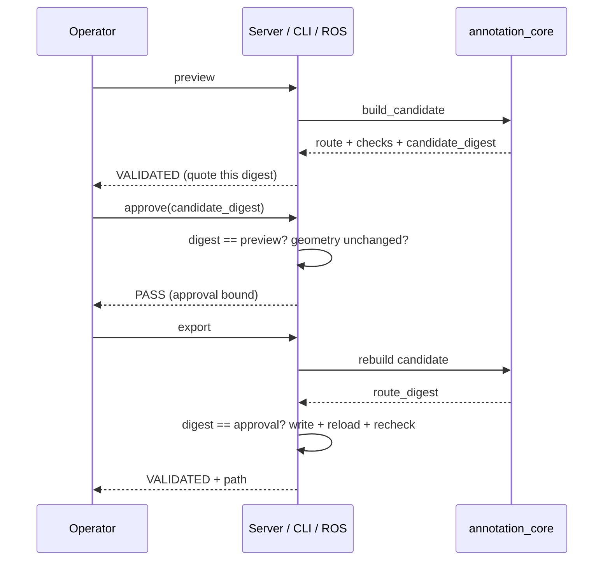
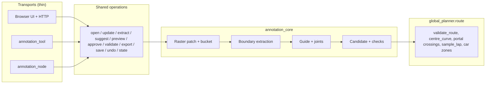
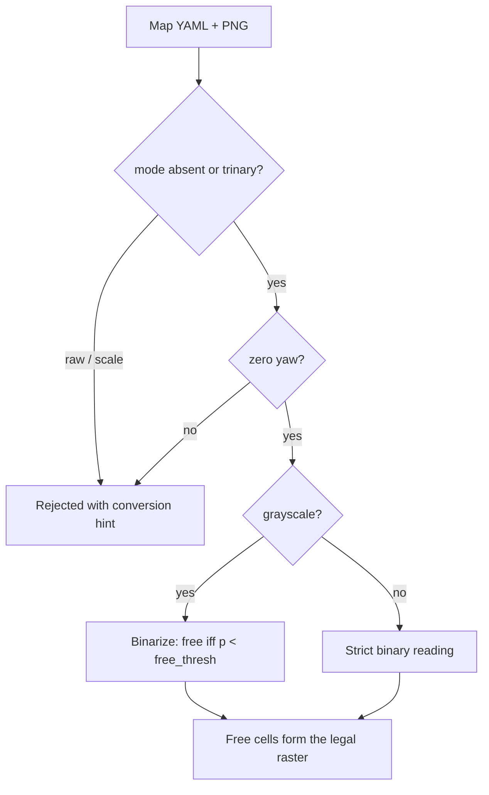

# Map annotation tool

Turns an occupancy-grid track map into a strict, validated
`global_planner.route` manifest (`{name, map, start, sections}`).
One operator, one machine, fully offline: open a map, repair legal
boundaries with two pencils, pick the retained track, draw or suggest
a directed guide loop, preview the candidate, approve exactly that
candidate, and export. Source maps are never written.

## Operator workflow



The browser UI groups controls by workflow (1 Map, 2 Road, 3 Route,
4 Review and Export, plus Draft and view) and shows a Stage chip
(Draft modified / Boundaries extracted / Preview validated / Approved /
Exported) derived from backend state.

## Session files and identity

Draft and export filenames are namespaced per source map —
`{parentdir}__{stem}__{bytesha8}__{ctxsha8}_annotation.json` /
`..._legal_route.json` — PNG content hash plus a context hash over
the enforced session identity (resolved directory, resolution,
origin, negate, image size, `free_thresh`), so two maps sharing one
PNG stem, and identical pixels under different YAML interpretations
(including different `free_thresh` values), can never silently share
a slot.

`free_thresh` joined the namespace after the scheme was introduced,
so a draft saved by an earlier revision of this unmerged branch keeps
the old filename and is not auto-discovered — the server opens a new
session and leaves the old file untouched. To recover it, rename the
old file to the current draft name
(`python3 -c "from global_planner.annotation.annotation_core import TrackMap, draft_name; print(draft_name(TrackMap('<map>.yaml')))"`
with `PYTHONPATH=planner/global_planner`) and reopen; loading still
validates the full stored identity and fails closed on mismatch.
`--session` CLI users are unaffected (explicit path, no discovery).

An approved route represents the interpreted snapshot (PNG bytes,
size, resolution, origin, negate, `free_thresh`) the operator
previewed; that identity is bound into every approval digest and
checked when a draft is reopened, so a draft can never be rebound to
a differently interpreted map. The editor works on the snapshot taken
at open — the browser displays those exact retained PNG bytes — and
never writes the source files. There are no repeated source-drift
re-reads: a file changed on disk after open is only picked up on
reopen.

## Trust chain: preview, approve, export

Approval binds two digests: the editor-input digest (map identity,
strokes, bucket seed, guide loop, thinning, name/surface/speed,
generator version) and the previewed manifest's `Route.digest`. Any
edit clears the candidate and revokes approval. Export rebuilds,
refuses unless the rebuilt digest equals the approved one, writes
atomically, then reloads the file and checks the digest again. The
manifest itself carries no approval state; that lives in the session
draft.



Preview, approve and export enforce the same digest binding on every
transport.

## Running it

```bash
# from the repo root, in an environment with the package's deps
# (numpy, opencv, scipy, shapely, jsonschema, pyyaml)
PYTHONPATH=planner/global_planner python3 -m global_planner.annotation.annotation_server \
  --maps stack_master/maps --out /tmp/annotation_out --port 8766
# open http://127.0.0.1:8766/
```

Add `--car stack_master/config/<CAR>/car_model.yaml --car-margin 0.05`
to also run the vehicle portal-zone stages for that car; without it
receipts report the car stages as NOT checked. There is no default
car.

Headless (same core):
`annotation_tool extract|preview|approve|export|validate|select-region --map <yaml> --session <json> [--out <dir>] [--car <yaml> --car-margin <m>]`
(`approve` quotes `--candidate <digest>` from `preview`).

ROS: `annotation_node` exposes the same operations as std_msgs/String
JSON on the relative topics `planner_annotation/command` →
`planner_annotation/state`, with `maps_dir`/`out_dir`/`car_model`/
`car_margin_m` ROS params. Every reply carries the `request_id` (when
given) and the session `revision`; a repeated id is acknowledged
`DUPLICATE` without re-applying. Run it only in an isolated namespace
and `ROS_DOMAIN_ID`, never in the driving launch; startup refuses the
ambient graph unless explicitly acknowledged:

```bash
ROS_DOMAIN_ID=169 ros2 run global_planner annotation_node --ros-args \
  -r __ns:=/annot -p maps_dir:=stack_master/maps -p out_dir:=/tmp/annotation_out
# topics: /annot/planner_annotation/command, /annot/planner_annotation/state
```

## How it works

Three thin transports share one set of session operations, one
geometry core, and the route package's own checks — so the browser,
the CLI and the ROS node cannot diverge.



### Source reading

Source PNG/YAML are read-only. Boundary strokes patch an in-memory
copy by adding occupied cells only (`negate: 1` supported by
inversion; `y = origin_y + (H-1-v)·res`, zero-yaw only).



Grayscale images are binarized at ingestion with ROS occupancy
semantics (`p = (255 - v) / 255`, inverted for `negate: 1`): a cell
counts as free only when `p < free_thresh` proves it, so occupied and
uncertain (gray) cells alike stay occupied and never become road.
Binary maps reduce to exactly the strict binary reading. Map YAML is
parsed with PyYAML (`yaml.safe_load`); only image, resolution, origin,
negate, mode and the thresholds pair are read, extra keys are ignored.

### Road selection and extraction

A stroke across a corner splits free space; the bucket click selects
the one 8-connected component that stays legal and the excluded pocket
is shaded. Legal free space only ever shrinks:
`Flegal ⊆ Fpatched ⊆ Foriginal`. Without a selection, extraction
answers `NEEDS_REGION_SELECTION` — it never silently keeps the
largest component.

Extraction takes the two loops of the legal region (outer boundary +
exactly one hole). Any other topology (open gap, split, extra island,
frame contact) is rejected instead of guessed at.

### Guide loop and route generation

Reverse Direction (Route group) reverses the stored guide's traversal
order in place — same start point, loop closure kept — through the
normal session update path, so it revokes preview and approval and
needs a fresh Preview Route; reversing twice restores the original
guide. Both directions build through the same route generation, so
left/right walls, section order, portals and start heading follow the
reversed travel. The button is disabled until a closed guide exists.

Guide closure contract (one rule everywhere): a guide counts as a
completed lap when its endpoint gap is at most 8 px. Storing a guide
whose gap is within that snaps it to exact closure (last point copied
from the first); a wider gap is stored as a draft but refused by
Preview/Validate/Approve/Export with an OPEN error — the generator
never silently wraps an unfinished loop into an approval. This gate
lives in candidate generation, so HTTP, CLI and ROS transports all
enforce it, including for approvals persisted before the gate
existed.

The Route Pencil is a direction and section-cut hint, not an exported
centreline: joints are placed at locally straight guide points
(4 sections), left/right walls are arcs of the extracted loops with
exact shared end-caps, thinned by deviation-bounded simplification
whose every chord is exact-ear-checked to annex zero area against the
legal cell squares (shape deviation vs the dense wall stays
≤ ~1.2 raster cells). The
route package derives each section's centreline from the walls;
preview draws that derived centreline, the gates and the start zone.
`Suggest Route` fills the pencil (dense-pairing spline, then
distance-ridge fallback), keeping the first seed that passes every
check, in the operator's drawn direction.

The start zone is the middle half of the road over the first 1.2 m of
section `s0`, following its walls — a starting suggestion, not a
surveyed grid slot. Name, surface and per-section `max_speed_mps`
(one value per section; all sections share the session value) are
editable metadata and approval-bound.

## What a PASS means

Preview/validate/export run, in order, failing closed at the first
bad stage:

1. `vector_legal` — exact continuous containment: the emitted
   section polygons (after thinning and cap re-pinning) must annex
   zero area over the occupied cell squares of the selected legal
   raster (boundary contact allowed).
   The generator guarantees this by construction — every
   simplification chord cuts off an ear whose exact occupied area
   is zero — and this stage re-verifies it independently on the
   final coordinates.
2. `manifest` — route `validate_route`: schema, simple CCW ribbons,
   shared caps, forward portals, contact rules, wall-derived
   centrelines inside their sections, and the whole start zone
   within the union of the section polygons.
3. `lap` / `portals` / `samples` — `centre_curve`,
   `portal_crossings` (exactly one forward crossing per gate),
   `sample_lap` at 0.25 m.
4. `car_zones` (only with `--car`) — `portal_zones` +
   `reach_boundaries` + anchored samples for that car's reach.

Not checked by anything here, and named in every receipt:
trajectory optimization / speed profile and continuous vehicle-body
or dynamics certification. A green preview is a valid route manifest,
not a certified racing trajectory.

`Validate` tries the two supported thinnings (0.02 m, then the
0.03 m envelope edge) through the same checks and locks the first
passing setting into the session.

Sessions are versioned (current: 4). Only current-version drafts
reopen; older drafts are rejected with a clear error rather than
migrated, so an approval can never silently carry across formats.

## Geometric contract

Emitted section polygons must cover zero area outside the union of
the selected legal raster cell squares; touching a wall edge (zero
area) is legal, and the numeric zero is `1e-9 m²`. This is enforced
twice by independent code paths: every simplification chord is
accepted only if the ear it cuts off has exactly zero occupied area
(construction), and an independent checker differences the final
polygons against the legal union and rejects any positive area
(certification). The whole start zone must lie within the union of
the section polygons, which chains with the above to keep it inside
the legal squares too.

## Qualification evidence

Verified at this PR head on real binary and grayscale ForzaETH maps
loading and validating end to end: exact zero-annexation legality
against an independent oracle (including corner cuts with bucket
selection), canonical start-zone and manifest contracts, car zones,
preview → approval → export integrity on the server, CLI and ROS
transports, and fail-closed topology. Exact cross-machine digests are
not asserted: the float pipeline can legitimately land on different
last-ulp branches across CPU/BLAS builds; within one environment it
is deterministic, which is what approval binds.

## Map support (fail-closed)

One planar ring in a zero-yaw occupancy map (binary or grayscale;
grayscale is read conservatively as above; YAML `mode` absent or
`trinary` only). Bridges/split courses, multiple holes and nonzero
yaw are rejected with a reason. The
manifest's `surface` string does not make this a 3D or multi-layer
editor.
