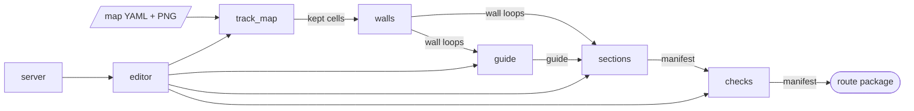

# annotation

A local web editor that turns an occupancy map from mapping into a route manifest
(`route/`), ready for the optimizer. The operator closes gaps in the walls, picks the track,
and draws (or asks for) a guide loop that sets the direction of travel; the editor builds the
sections and checks them.

```bash
ros2 run global_planner annotation --maps stack_master/maps
# then open http://127.0.0.1:8766
# --car stack_master/config/NUC5/car_model.yaml also checks the portal zones for that car

# without a browser: check and export saved drafts again, e.g. after changing this code
ros2 run global_planner annotation --maps stack_master/maps --export test/test baku/baku
```

It writes two files next to the map's YAML and never touches the map itself:

| File | Holds |
|---|---|
| `<map>_annotation.json` | the draft: strokes, picked region, guide, start, route name, surface, speed limit |
| `<map>_route.json` | the exported route manifest |

## Using it

1. **Open** a map. Set the route name, surface and speed limit; they apply to every section.
   The view frames the track, and frames it again whenever the track changes.
2. **Draw wall** wherever the map leaves a gap, so the track is one closed ring. Strokes only
   add occupied cells, and a wall must start and end on a wall of the map: one that touches
   none is refused, and stays on screen to fix. The largest piece of free space that is a
   closed ring is kept as the track; **Pick region** keeps another. The blue lines are the
   road's walls; orange is free space left out of the road.
3. **The guide** sets the direction and roughly where the sections are cut; it is not
   exported. Once the track is closed, the road's midline is suggested and follows the road
   as walls change. **Draw guide** replaces it with your own loop, which then stays as drawn;
   **Suggest** goes back to the midline. **Reverse** turns it round. It must stay on the road
   all the way round.
   Wherever the route fails (a guide through a wall, a start off the road, a section off the
   road) is ringed in red; a refused wall shows dashed red for a moment, and the status says why.
4. **Set start**: draw the start line with two clicks, one on each side of the road. The
   line through them is run on to the walls and is the first gate; the others follow at
   quarters of the lap, each on the straightest point near it. There is no route until the
   start is set.
5. After every edit the route is built and checked again, and the status says whether it is
   valid or why not; a valid one shows green walls, magenta gates and the white start line.
   **Export**, enabled only then, writes exactly that route.

The left tool box holds the drawing tools and wall width. Use **Edit** to remove a numbered
wall, **View** to toggle overlays or fit the track, and **Help** for the workflow. Scroll the
wheel to zoom, or drag with the right or middle mouse button to pan.

## How it works



| Module | Does |
|---|---|
| `track_map.py` | reads the map; the free cells left by the strokes, and the region kept |
| `walls.py` | the two wall loops of the kept ring; finds the track; exact area checks and wall thinning |
| `guide.py` | resamples a guide, checks it stays on the road, and suggests the midline |
| `sections.py` | cuts the guide into sections, the first at the start, and takes their walls |
| `checks.py` | the checks a manifest must pass before it can be exported |
| `editor.py` | the open map, the draft, its edits and files |
| `server.py` | the local web server and the command line |
| `ui.html` · `ui.js` | the page |

1. **Free cells.** A cell is free only when its occupancy is below the map's `free_thresh`:
   unknown cells stay occupied. Strokes add occupied cells; a free cell in no 2x2 block of
   free cells is dropped too, a sliver no car fits in. Picking a region keeps only the free
   cells connected to it.
2. **Walls.** The kept cells must form one ring clear of the image edge: one outer boundary
   and one hole, never one cell wide. Anything else is refused, never guessed at.
3. **Cuts.** The guide is resampled (at least 64 points round the lap), smoothed and pulled
   into the middle half of the road; the way it turns says which wall is on the left. It is
   cut into four sections near even quarters of the lap, each cut on the straightest guide
   point nearby where the nearest point of each wall lies on its own side. A cut's gate
   joins those two points.
4. **Section walls.** Each wall is walked one way round for the whole lap, the way that
   passes the gates in order in one turn. Each section takes the stretches between its
   gates, thinned to keep the route package's centreline fast; a shortcut is only taken
   when the ear it cuts off covers no occupied area at all.
5. **Start line.** The first gate, where the operator drew it: the line through the two
   clicks, run on to the nearest place it meets each wall. It runs from wall to wall, so it
   pins nothing about the line. A draft whose start is a single click gets the gate that fits
   nearest after it.
6. **Checks**, the first failure refusing the route: the sections cover no area outside the
   kept cells' squares, measured exactly; the route package reads the manifest, builds the
   lap, finds its gate crossings and samples it; given a car, it works out the portal zones.

## Legality

A cell is the closed square of side `resolution` around its pixel. With `L` the union of
the kept cells' squares and `P` the union of the exported sections, the route holds
**`area(P \ L) = 0`**: touching an occupied square is allowed, covering any of it is not.
So no occupied island, left-out pocket or narrow gap can be covered or bridged, however
small; everything that follows from the operator's strokes and region holds exactly.

It is held twice, by separate code:

1. **By construction.** The traced walls run through the centres of the boundary's free
   pixels, which already holds it. Thinning takes a shortcut only when the ear between the
   shortcut and the points it replaces covers exactly zero occupied area
   (`walls.ear_ok`; an ear that crosses itself is measured lobe by lobe). Shortcuts may stray
   anywhere inside `L`; the distance bound only keeps the walls close in shape.
2. **By measurement.** `checks.check` subtracts `L`, built exactly from one box per run of
   free cells, from every exported section and refuses any area left. This does not rely on
   the argument in 1, and catches a regression in the generator.

Zero is `1e-9 m2`, numeric noise in the area sums; real overlaps are a million times
larger. The price is that the road is up to half a cell narrower on each side than `L`.

What else was weighed:

| Instead | Why not |
|---|---|
| A tolerance: overlap allowed up to some depth or area | A one-cell exclusion the operator drew is as small as the staircase noise of a wall, so no threshold tells them apart; and zero is reachable, so a tolerance buys nothing. |
| Shrink `L` by a cell and build on that | Narrows every road by 5 to 8 %, can cut narrow necks, and made the walls of a cut baku cross. |
| Trace walls on cell edges instead of centres | Rewrites extraction and joints for no gain: the ear check already uses the half cell of margin the centres leave. |
| Topology-preserving simplification (shapely `preserve_topology`, Visvalingam, ...) | Keeps the walls from crossing, but says nothing about staying inside `L`; the ear check is what they lack. |

## Limits

- Only maps with zero yaw (`origin[2]`) and the trinary occupancy convention.
- One closed ring, four sections, one surface and one speed limit for the whole lap.
- The suggested guide is the road's midline, always on the road; where the road is much
  wider on one side, its cuts may fall badly, and the guide is redrawn there.
- Exact coordinates, and so manifest digests, can differ in the last digits between
  machines and library versions; within one environment the same draft gives the same
  route.
- The map is read once, at open: a map file changed on disk is seen on the next open.
