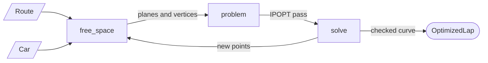

# optimizer

Finds a line of least curvature around a route for one car, with the car's whole body on legal
road. It builds on `route/` and solves each pass with IPOPT through CasADi.

```python
from global_planner.car import Car
from global_planner.optimizer.solve import optimize
from global_planner.route.manifest import load_route

route = load_route('track.json')
car = Car.load('car_model.yaml', margin_m=0.05)
result = optimize(route, car)           # starts from the centre curve
result.lap                              # the optimized LapCurve
result.start_q                          # lap progress of the pose in the start box
result.passes, result.refinements       # what each pass did; rounds of tighter rows
```

## How it works

The line is a ring of points. The first point of each section sits on the gate into it, the
others at equal gaps from there, at most `spacing_m` apart when the passes begin. Between
points the body follows the cubic that leaves both along their headings, which stays close to
the final spline.

1. **Pick the walls** near every pose of the body and every `base_link` (`free_space.py`).
2. **One pass:** IPOPT lowers the curvature energy `sum k^2 ds`, keeping to those walls and
   moving no coordinate more than the step (`problem.py`).
3. **Repeat** until a pass moves no point more than `settle_m`, or cannot lower the energy by
   more than `settle_gain` of it (`solve.py`).
4. **Check the curve.** The points become a lap curve again (`refit_lap`), which is what the
   car follows. It is checked every `check_m` and at its knots. Where it goes beyond what the
   points were held to, the rows tighten by that much and the passes go on, up to
   `max_refinements` times.



| File | One job |
|---|---|
| `free_space.py` | where the car may be, as the walls near a pose |
| `problem.py` | one pass as a nonlinear program: objective and rows |
| `solve.py` | the points, the passes, the step, the settle rule, the checked curve |

## What a pass keeps to

A **row** is one thing the line must keep, written as a value in metres that must not be
negative.

| Row | What it says |
|---|---|
| equal gaps | within a section each point stays as far from the next as from the one before, so points cannot slide along the line: only its shape is free |
| gates | the first point of each section stays on its gate's line, so the curve crosses each gate exactly where the section begins in `q` |
| body on the road | the body rectangle (`Car.body`) keeps its clearance from the walls, at every point, halfway to the next, and wherever a wall corner passes its front or rear |
| `base_link` in its section | ownership by `q` must match where the point is |
| turning | the curvature at every point is at most one over the car's turning radius, wheelbase / tan(max steering angle) |
| start | of the points in the start box, the one nearest its middle (among those facing within the heading range, if any) stays in the box and faces within the range |

**The road** of a section is the section plus the supports of the portals at its two ends. A
body whose `base_link` is in its section can only reach a neighbour through the gate, and then
that portal applies, so this is the portal rule. `route` rejects a section too short for the
car, so a body never lies across three sections.

**A wall near a pose** becomes one of two rows, exact where the contact is. Where a corner of
the body is nearest the wall, a *plane*: every corner of the body stays beyond the wall's line.
Where an edge of the body is nearest, a *vertex*: the wall's two ends stay beyond that edge,
which turns with the body.

**Clearance** is the margin plus a small reserve for the curve between two poses, which bulges
past the straight line between them by at most `d^2 k (1 + r k) / 8` for poses `d` apart at
curvature `k`. The reserve is taken at the car's turning limit. It is not what makes the line
legal, the checked curve is; it spares most lines a refinement.

## How a pass is solved and judged

- **Straight rows.** Within a pass every row but the gaps and gates is taken as a straight
  line: its value at the start and how it changes with the first move. Only the energy, the
  gaps and the gates keep their bends.
- **Elastic rows.** A row that is not met yet (a start off the road, too tight, or facing the
  wrong way) may fall short at a cost of `elastic` per metre, so IPOPT pulls the line back.
  A row within `met_m` of met counts as met.
- **A pass counts** only if the true rows bear its straight rows out. From a legal line,
  every true row must still be met after it, so the line stays legal and the energy falls.
  From a line that is not legal yet, the true rows must come at least half as much closer as
  the straight rows said.
- **Walls are picked anew** for every pass, and a wall corner then passes the body at another
  moment than before. There the line can be a few millimetres short again; that pass brings
  it back before the energy falls further.
- **Corrections.** Where the body turns around a wall corner its row bends, and the straight
  row says too much. Every row is then shifted to where it truly ended and the pass is solved
  again from the same start.
- **The step.** A pass that still does not count is tried again with half the step. The step
  doubles again after a pass that counted without a correction.
- **Nothing to gain.** IPOPT resolves the cost of a pass, the energy plus what the rows fall
  short, to about a millionth of it. A pass that cannot lower it by more than `settle_gain`
  leaves the line where it is.

## What it promises

- **Legal:** on the returned curve, every `check_m` and at its knots, the body plus margin lies
  on its road, `base_link` in its section, and the start pose in the start box. The turning
  limit and the start heading hold to within a thousandth.
- **Settled:** the last pass could have moved twice as far, and moved no point more than
  `settle_m` or had no more than `settle_gain` of the energy to gain.
- **Falling energy:** a pass that starts from a legal line keeps every wall it picked and
  never raises the energy.
- **Refusal:** a road narrower, or turning tighter, than the car can drive raises
  `OptimizerError` instead of returning a line, and so do settings that cannot work.

## What it does not promise

- **The best of several lines.** Minimum curvature can have more than one answer. On a U-turn
  between two straights, sliding the turn along the straights hardly changes the curvature, so
  a line through the inner corner and one around the outside can be equally good, and much
  apart in length. Along such a stretch the energy is flat to about a thousandth, so where on
  it the line comes to rest depends on the start too. The optimizer returns the line its start
  leads to; from the centre curve that is always the same. Choosing between them is for the
  lap-time stage that follows.
- **Proof between checks.** The curve is checked at samples. Proving the body on the road
  continuously along the whole line is the geometry checker's job.
- **Lap time.** The objective is curvature, not time. Lap times on the synthetic tracks are
  for comparing methods only, never for tuning.

`test/test_optimizer.py` checks, on synthetic stadium tracks: legality (with a rule written
apart from the optimizer's own check), the start pose, short sections, starts on and off the
road (a legal line of the same energy from each, and no pass that leaves a legal line worse),
a binding turning limit, a tight bend at a fine spacing, and the refusals.
