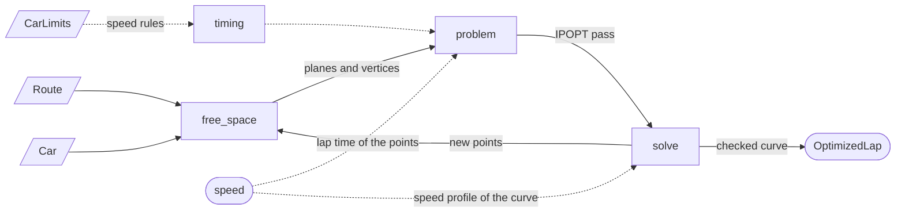

# optimizer

Finds the smoothest line around a route for one car, the line of least curvature, with the
car's whole body on legal road. Given the car's limits (top speed, grip, motor, steering) it
goes on to the fastest line, with a share of that smoothness kept. It builds on `route/` and
`speed/`, and solves each pass with IPOPT through CasADi.

```python
from global_planner.car import Car, CarLimits
from global_planner.optimizer.solve import optimize
from global_planner.route.manifest import load_route

route = load_route('track.json')
car = Car.load('car_model.yaml', margin_m=0.05)
result = optimize(route, car)           # the smoothest line; starts from the centre curve
result.lap                              # the optimized LapCurve
result.start_q                          # lap progress of the pose in the start box
result.passes, result.refinements       # what each pass did; rounds of tighter rows

limits = CarLimits.load('car_model.yaml')
result = optimize(route, car, limits=limits)    # the fastest line, from the smoothest one
result.profile                                  # its speeds and lap time (speed/)
```

## How it works

The line is a ring of points. The first point of each section sits on the gate into it, the
others at equal gaps from there, at most `spacing_m` apart when the passes begin. Between
points the body follows the cubic that leaves both along their headings, which stays close to
the final spline.

1. **Pick the walls** near every pose of the body and every `base_link` (`free_space.py`).
2. **One pass:** IPOPT lowers the curvature energy `sum k^2 ds`, keeping to those walls and
   moving no coordinate more than the step (`problem.py`).
3. **Repeat** until a pass moves no point more than `settle_m`, or cannot lower what it is
   lowering by more than `settle_gain` of it (`solve.py`).
4. **Check the curve.** The points become a lap curve again (`refit_lap`), which is what the
   car follows. It is checked every `check_m` and at its knots. Where it goes beyond what the
   points were held to, the rows tighten by that much and the passes go on, up to
   `max_refinements` times.
5. **With the car's limits, go on for lap time.** The same passes continue from that
   smoothest line with a second aim (see "The fastest line"), and the curve is checked again,
   with up to `max_refinements` tightenings of its own.



The dotted arrows are only there when the fastest line is asked for.

| File | One job |
|---|---|
| `free_space.py` | where the car may be, as the walls near a pose |
| `problem.py` | one pass as a nonlinear program: objective and rows |
| `timing.py` | lap time and the car's speed rules over one gap, written for the solver |
| `solve.py` | the points, the passes, the step, the settle rule, the checked curve |

## What a pass keeps to

A **row** is one thing the line must keep, written as a value that must not be negative. The
rows below are in metres; the speed rules of the fastest line come in their own units.

| Row | What it says |
|---|---|
| equal gaps | within a section each point stays as far from the next as from the one before, so points cannot slide along the line: only its shape is free |
| gates | the first point of each section stays on its gate's line, so the curve crosses each gate exactly where the section begins in `q` |
| body on the road | the body rectangle (`Car.body`) keeps its clearance from the walls, at every point, halfway to the next, and wherever a wall corner passes its front or rear |
| `base_link` in its section | ownership by `q` must match where the point is |
| turning | the curvature at every point is at most one over the car's turning radius, wheelbase / tan(max steering angle) |
| start | of the points in the start box, the one nearest its middle (among those facing within the heading range, if any) stays in the box and faces within the range |

**The road** of a section is the section plus the supports of the portals at its two ends. A
body whose `base_link` is in its section can only reach a neighbour through the gate, and then
that portal applies, so this is the portal rule. `route` rejects a section too short for the
car, so a body never lies across three sections.

**A wall near a pose** becomes one of two rows, exact where the contact is. Where a corner of
the body is nearest the wall, a *plane*: every corner of the body stays beyond the wall's line.
Where an edge of the body is nearest, a *vertex*: the wall's two ends stay beyond that edge,
which turns with the body.

**Clearance** is the margin plus a small reserve for the curve between two poses, which bulges
past the straight line between them by at most `d^2 k (1 + r k) / 8` for poses `d` apart at
curvature `k`. The reserve is taken at the car's turning limit. It is not what makes the line
legal, the checked curve is; it spares most lines a refinement.

## How a pass is solved and judged

- **Straight rows.** Within a pass every row of the table above but the gaps and gates is
  taken as a straight line: its value at the start and how it changes with the first move.
  The energy, the gaps and the gates keep their bends, and so do the lap time and the speed
  rules when the fastest line is asked for.
- **Elastic rows.** A row that is not met yet (a start off the road, too tight, or facing the
  wrong way) may fall short at a cost of `elastic` per metre, so IPOPT pulls the line back.
  A row within `met_m` of met counts as met: it is not pulled back, and may not get worse.
- **A pass counts** only if the true rows bear its straight rows out. From a legal line,
  every true row must still be met after it, so the line stays legal and its cost falls.
  From a line that is not legal yet, the true rows must come at least half as much closer as
  the straight rows said.
- **Walls are picked anew** for every pass, and a wall corner then passes the body at another
  moment than before. There the line can be a few millimetres short again; that pass brings
  it back before the energy falls further.
- **Corrections.** Where the body turns around a wall corner its row bends, and the straight
  row says too much. Every row is then shifted to where it truly ended and the pass is solved
  again from the same start.
- **The step.** A pass that still does not count is tried again with half the step. The step
  doubles again after a pass that counted without a correction.
- **Nothing to gain.** The cost of a pass is what it lowers plus what the rows fall short.
  IPOPT resolves the energy to about a millionth of it, and a pass that cannot lower the
  cost by more than `settle_gain` leaves the line where it is. With the lap time in the cost
  IPOPT resolves about a hundred-thousandth, so that is the least such a pass must gain.

## The fastest line

Asked with `limits`, the optimizer first finds the smoothest line as above and then goes on.

- **What the passes lower** is now a mix:
  `lap time / lap time of the smoothest line + smoothness x energy / energy of the smoothest line`.
  Both are measured against the smoothest line, so `smoothness` is a plain number: with 0.1,
  one per cent of lap time is worth giving up ten per cent of smoothness for.
- **Why a share of smoothness is kept.** Where the track's speed limit holds the car back
  all the way round, the fastest line is simply the shortest. Chasing that alone makes the
  line harsh, the car's own limits start to bite, and the passes get stuck: with
  `smoothness` 0 the optimizer failed or came out slower on three of four tracks tried.
- **Speeds in the solver.** The speed at every point joins the points as unknowns. The
  car's speed rules are those of `speed/` (the bend, speeding up and braking with shared
  grip at both ends of a gap, the steering), written in `timing.py` for one gap and applied
  to every gap of the lap. They keep their bends in a pass. The walls, the turning limit
  and the start heading are still taken as straight lines.
- **Speed rows left out.** Most speed rows cannot bind in a pass; on a lap driven at the
  track's limit none can. A gap's speed rows are given to the solver only if one of them is
  within half its limit of binding where the solve starts. The answer is then held against
  the rows of every gap: if it breaks one that was left out, that gap is kept and the pass
  is solved again. The answer that comes out keeps every row, for far less work.
- **The track's limit** at a point is its section's, or the lower of two within a portal's
  reach. A point also keeps to the limits of its two neighbours, so that a gap is driven at
  the lower limit of its ends; just outside a reach that is a little stricter than the speed
  profile. The limits are looked up for every pass, from where the points are when it
  begins, and the solver is held to them and to the car's top speed.
- **The lap time that counts.** Before a pass and after it, the points are driven as fast as
  the car can by `speed/points.py`, both times with that pass's limits. A pass counts only
  if the mix falls by that measure; the solver's own speeds do not decide that. Moved points
  that cannot be timed at all are a pass that does not count.
- **The solver is checked against that lap time.** After every solve the lap time by the
  solver's own speeds is held against the one `speed/` works out for the same points and
  limits. They agree to a hundred-thousandth while `timing.py` and `speed/` state the same
  rules; if they are a thousandth apart the run stops and says so.
- **Two lap times.** The passes go by the lap time of the points: their own curvature, gaps
  of `spacing_m`. The result carries the speed profile of the finished curve,
  `result.profile`, on a finer grid. Where the track's limit holds the car back they agree
  closely. Where the car's own limits bind they differ by a few per cent, because the curve
  ripples a little between its points and the profile sees that: a lower `smoothness` can
  then give a better lap time of the points and a worse one of the profile. The profile's is
  the one to report, and the one to choose `smoothness` by. `result.smoothest_time_s` is the
  lap time of the smoothest line's points, which each pass's `time_s` can be held against.
- **One car.** `car` and `limits` must come from the same car file. A car with little grip
  may need a smaller `spacing_m`: the speed rules ask for points close enough for the bend
  between them, and here that is asked of the optimizer's points.

## What it promises

- **Legal:** on the returned curve, every `check_m` and at its knots, the body plus margin lies
  on its road, `base_link` in its section, and the start pose in the start box. The turning
  limit and the start heading hold to within a thousandth.
- **Settled:** the last pass could have moved twice as far, and moved no point more than
  `settle_m` or had too little left to gain.
- **Falling cost:** a pass that starts from a legal line keeps every wall it picked and
  never raises the energy; once the lap time is aimed at, never the mix of the two as
  measured with that pass's limits.
- **Refusal:** a road narrower, or turning tighter, than the car can drive raises
  `OptimizerError` instead of returning a line, and so do settings that cannot work and a
  lap that cannot be timed for the car.

## What it does not promise

- **The best of several lines.** Minimum curvature can have more than one answer. On a U-turn
  between two straights, sliding the turn along the straights hardly changes the curvature, so
  a line through the inner corner and one around the outside can be equally good, and much
  apart in length. Along such a stretch the energy is flat to about a thousandth, so where on
  it the line comes to rest depends on the start too. The optimizer returns the line its start
  leads to; from the centre curve that is always the same. Asked for the fastest line, the
  passes go on from there towards the faster of them.
- **Proof between checks.** The curve is checked at samples. Proving the body on the road
  continuously along the whole line is the geometry checker's job.
- **The very fastest line.** A share of smoothness is kept unless `smoothness` is set to
  0, which often fails. The passes stop at the first line they cannot improve, which need
  not be the best there is.
- **A real lap time.** The lap time is the speed profile's, from the car file's numbers.
  Lap times on the synthetic tracks are for comparing methods only, never for tuning.
