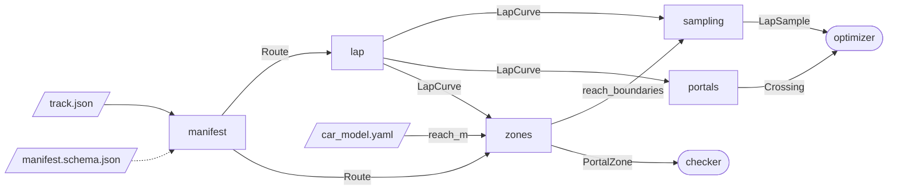

# route

Turns an annotated track (a JSON manifest) into the geometry the planner works on: the track's
sections and portals, a smooth closed curve through their centrelines, samples along it, and
where the curve crosses each portal gate.

```python
from global_planner.car import Car
from global_planner.route.lap import centre_curve
from global_planner.route.manifest import load_route
from global_planner.route.portals import portal_crossings
from global_planner.route.sampling import sample_lap
from global_planner.route.zones import portal_zones, reach_boundaries

route = load_route('track.json')        # validated, immutable Route
lap = centre_curve(route)               # closed curve through every section's centreline
crossings = portal_crossings(lap)       # one forward crossing per portal, in lap order

car = Car.load('car_model.yaml', margin_m=0.05)
zones = portal_zones(route, car.reach_m)                     # where each portal applies
boundaries = [q for z in zones for q in reach_boundaries(lap, z)]
samples = sample_lap(lap, 0.25, extra_anchors=boundaries)    # every 25 cm, plus the anchors
```

## Pipeline



| File | One job |
|---|---|
| `manifest.py` | read JSON → validated `Route` (structure via the schema, geometry by hand) |
| `manifest.schema.json` | the manifest's structure: fields, types, ranges |
| `track.py` | the data: `Section`, `Portal`, `Start`, `Route` |
| `centreline.py` | a section's centreline, derived from its walls |
| `lap.py` | lap progress `q`; the closed curve through all centrelines (`LapCurve`) |
| `sampling.py` | samples along the lap; refit a curve through moved samples |
| `portals.py` | where the curve crosses each gate: once, forwards, in order |
| `zones.py` | where each portal applies for a given car, and its support area |
| `cubic.py` | one cubic piece: evaluation, arc length and its inverse (scipy) |
| `curve.py` | closed curve of cubic pieces, queried by distance `s` |
| `geometry.py` · `tolerances.py` · `errors.py` | helpers |
| `../car.py` | the car: body from the stack's `car_model.yaml`, plus the planner's margin |

## The track

A lap is a ring of **sections**, at least 3: with two, gluing neighbours at both of their
shared caps would close a ring around the infield. Each section has two walls; its
**centreline**, the line equally far from both, is derived from them and runs from the middle
of its start cap to the middle of its end cap. Every distance along a section is measured on it.
Past the end of the shorter wall, "equally far" no longer means the middle of the road, so keep
caps roughly square to the walls: on a 1 m wide road a cap 60° off square moves the centreline
about 11 cm off the middle, and much steeper caps can make the centre curve cross its gate
backwards.

Sections meet only at their gates: walls of two sections must not run along each other (a
barrier needs a thickness), and neighbours must neither overlap nor touch elsewhere around a
gap. Sections that are not neighbours may overlap where one passes over the other, as a bridge
over the road below, and their walls cross at points there; so where the road crosses itself,
the two passes must lie in sections that are not neighbours.

A section's end cap is the **gate** into the next section. Near it, the car's body can
overlap both sections, so both count as road there. How near depends on the car, not on the
track: a **portal zone** applies wherever `base_link` is within the car's `reach_m` (furthest
body corner from `base_link`, plus the planner's margin) of the gate, on a piece of one of the
two sections it joins. The reach comes from a `Car` (`global_planner/car.py`, read from the
stack's `car_model.yaml`). Being a distance in the plane, not along the lap, it holds for any
line, on hairpins and oblique gates alike. The section the car is on always counts as road for
it; the **support** only adds where the body may spill into the neighbour. A body never lies
across three sections: a section whose two gates come closer than the car's reach is rejected
for that car.

```
          left wall                    gate = end cap of s0
   ──────────────────────────────────────────┬──────────────────────────────────
                                    ┌────────┼────────┐  support: both sections,
   s0    centre ●───●─────●─────●───┼────────●────────┼──●─────●─────●     s1
                                    └────────┼────────┘  within reach of the gate
   ──────────────────────────────────────────┴──────────────────────────────────
          right wall                ├─reach──┼─reach──┤
                                      applies here, measured from the gate
```

## Manifest

```json
{
  "name": "test_track",
  "map": {"frame_id": "map", "sha256": "49efc38e…"},
  "start": {
    "heading_range_rad": [2.01, 2.61],
    "zone": [[3.01, 3.71], [1.65, 5.18], [0.48, 4.10], [1.83, 2.63]]
  },
  "sections": [
    {
      "uid": "o0",
      "surface": "ground",
      "max_speed_mps": 2.5,
      "left": […],
      "right": […]
    }
  ]
}
```

| Field | Meaning |
|---|---|
| `start` | the start box the car stands in before the race (`zone`), and the directions it may face there (`heading_range_rad`) |
| `surface` | groups sections on one physical surface (a bridge deck vs. the road below) |
| `max_speed_mps` | speed limit over the whole section; to change it, cut a new section |
| `left`, `right` | the walls, in driving direction; `right` + reversed `left` closes the section; the end cap is the gate into the next section, the last one closes the lap |

## Symbols

| | |
|---|---|
| `s` | distance along the current curve, metres; a point's `s` is also called its station |
| `q` | lap progress along the section centrelines; stays fixed while the curve moves |
| `t` | position inside one cubic piece, 0 to 1 |

## Errors

| Error | Raised when |
|---|---|
| `RouteError` | the manifest is malformed or inconsistent; also when, within a car's reach of a gate, the road is not one piece without holes, or a section is too short for the car |
| `GeometryError` | a curve is unsupported, numerically uncertain or over budget |
| `LapError` | a lap curve, sample or gate crossing is invalid or ambiguous |
| `ValueError` (from `Car`) | a car file lacks a body key, a value is not a finite number or is negative, or the body has no width or no length |

## What is not checked here

`route` checks the track, not a line. Whether the car's whole body stays on legal road along a
planned line is for a separate geometry checker, built on the portal zones. The ROS export
will compute the `d_left`/`d_right` widths itself, as the distance to the first wall the normal
ray hits.
