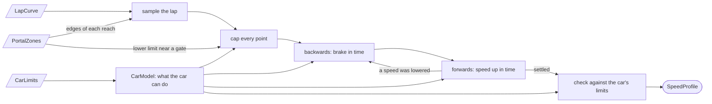

# speed

Gives every point of a lap the fastest speed that the track's limits and the car allow, and
the lap time that follows. It builds on `route/` and needs no solver.

```python
from global_planner.car import Car, CarLimits
from global_planner.route.zones import portal_zones
from global_planner.speed.speeds import speed_profile

car = Car.load('car_model.yaml', margin_m=0.05)
limits = CarLimits.load('car_model.yaml')
profile = speed_profile(lap, portal_zones(lap.route, car.reach_m), limits)
profile.samples                             # the points of the lap
profile.points.speed_mps                    # the speed at each point
profile.points.accel_mps2                   # the steady acceleration to the next point
profile.points.cap_mps                      # the most each point allows by itself
profile.time_s, profile.lap_time_s          # when the car passes each point; one flying lap
```

`lap` is any `LapCurve` the car can steer along; the optimizer's line is one. A lap that
turns tighter than the car can is refused.

## How it works

1. **Sample the lap** on a grid of `spacing_m`, and at every knot of its curve (where the
   curvature peaks), every section start and wherever the line enters or leaves a portal's
   reach. Grid points next to one of those are left out, so two points can be up to twice
   `spacing_m` apart.
2. **Refuse the lap** if it turns tighter anywhere than the car can steer: no speed makes
   that drivable.
3. **Cap every point** by what it allows by itself: the track limit, the car's top speed, the
   speed its tyres hold the bend at, and the speed its steering keeps up with.
4. **Backwards around the lap**, lower each speed until the car can brake in time for the
   next point.
5. **Forwards around the lap**, lower each speed until the car can speed up to it from the
   point before.
6. **Repeat** 4 and 5 until a round lowers no speed by more than `resolved_mps`.
7. **Check the result** against the car's limits, and refuse it if it breaks one.

Speeds are only ever lowered.



| File | One job |
|---|---|
| `model.py` | `CarModel`: one car with the planner's grip setting, asked what it can do at a speed on a bend: hold it, speed up, brake, steer |
| `points.py` | `LapPoints`: the points of a lap with what each allows, worked out once, and the passes and the check on them |
| `speeds.py` | `speed_profile`: samples the lap, finds the track limit of every stretch, and hands the points over; the settings and the result |
| `errors.py` | `SpeedError` |
| `../car.py` | `CarLimits`: the car's limits, read from the stack's `car_model.yaml` under the same names |

## The limits

| Limit | What it says |
|---|---|
| track | each section has one speed limit. Within a portal's reach the body may be on both sections, so the lower of the two limits applies there |
| top speed | the car's own |
| bend | holding a bend of curvature `k` at speed `v` takes `v^2 |k|` of sideways grip, and the car has only so much |
| turning | the lap turns no tighter anywhere than the car can steer, `wheelbase / tan(max_steering_angle)`, to within a thousandth as the optimizer holds it; otherwise it is refused |
| steering | between two points the steering angle, `atan(wheelbase k)`, changes no faster than the car steers. Both points are capped at the speed that takes the gap in just that time, which is on the safe side |
| speeding up | from one point to the next the car speeds up no harder than its tyres and its motor allow, less the air drag: its highest acceleration |
| braking | and brakes no harder than its tyres allow, helped by the air drag: its lowest acceleration, a negative number |

**Shared grip.** What the tyres use sideways they do not have along the car. How much is
left is set by `grip_exponent`: with 1, what is used sideways comes off the grip along the
car part for part; with 2 the two share an ellipse, which leaves more. The default is 1, the
more careful one, which is what the stack's planner used. The formula is in `model.py`.

**Between two points** the car speeds up or brakes steadily. That acceleration must lie
between the lowest and the highest the car can make (`CarModel.accel`), at both points.

## Car settings

Everything in `CarLimits` comes from `car_model.yaml`, under the same names:

| Key | Meaning |
|---|---|
| `m`, `wheelbase`, `v_max` | mass, wheelbase, top speed |
| `a_max`, `a_min` | the most the tyres speed the car up and slow it down, driving straight; `a_min` is negative |
| `a_lat_max` | the most the tyres hold it in a bend |
| `a_motor` | the most the motor speeds it up at a speed: `[m/s, m/s2]` points, straight between them, level beyond the ends, never rising, and above zero at the first |
| `drag_coeff` | air drag force divided by the speed squared |
| `max_steering_angle` | the furthest the front wheels turn |
| `max_steering_velocity` | the fastest the steering angle changes |

`a_lat_max`, `a_motor` and `drag_coeff` are new and set for NUC5 only; `CarLimits.load` says
which keys a car file lacks. Their values are copied from what the old planner shared between
all cars (`veh_dyn_info/ggv.csv`, `ax_max_machines.csv`, and `dragcoeff` in
`racecar_f110.ini`); they are not measured on the car and need remeasuring.

**Not what the old planner drove with.** Its shared table gave 12 m/s2 of grip in every
direction. Only the sideways 12 is carried over. Forward and braking grip are now the car
file's own `a_max` and `a_min`, which are lower for every car, so this profile speeds up and
brakes more gently than the old planner's on the same line.

## What it promises

- **Every limit holds** at every point, and from each point to the next. Speeds are held to
  within `resolved_mps`; for an acceleration that is this much speed over its gap.
- **The track limit holds between points too,** since the points include every place where it
  changes. One case escapes: a line that clips a portal's reach for less than an eighth of a
  curve piece is not seen to enter it, and keeps the higher limit there.
- **Checked before it is returned:** `speed_profile` checks its result against the car's
  limits: top speed, the bend, the steering, and both ends of what the car can speed up and
  brake by. The check asks the car about all points at once and does not use the passes, so
  a mistake in the passes that leaves a speed too high cannot hide in it. The track limit
  is not checked again: it comes in as a cap, and the speeds never rise above their caps.
- **The fastest profile for its points when `grip_exponent` is 1,** under the limits as
  they are applied here. This rests on two points always being close enough for the bend
  between them; a lap with a longer gap is refused (the rule is in `points.py`). On every
  lap tried no faster profile kept the limits; it is not proven.
- **A closed lap:** the car passes the first point at the speed it reaches at the end.
- **A result that stays as found:** the arrays of a returned profile cannot be written to.
- **Refusal:** settings or car values that cannot work raise `SpeedError` or `ValueError`.
  So do a lap that turns tighter than the car can steer, zones that are not the portal
  zones of the lap's route, two points too far apart for the bend between them, and speeds
  that do not settle in `max_rounds`.

## What it does not promise

- **A start from standstill.** The lap is a flying lap: the car is already at speed when
  it passes the first point.
- **The very fastest profile when `grip_exponent` is above 1.** There, lowering one speed
  can make room for a neighbour, which the passes do not look for: a slightly faster profile
  can exist, and the result can depend a little on where the lap's first point is.
- **More speed than the steering cap gives.** It is stricter than its rule needs.
- **That less air drag is faster.** The drag helps the car brake, so a car with less of it
  has to brake earlier and can lose more there than it gains on the straights.
- **The bend between points.** The sideways grip is checked at the points, which include the
  knots where the curvature peaks, not between them.
- **A car model beyond these limits.** No tyre model, weight transfer or slope; the limits
  are the car file's numbers.
- **A real lap time.** Lap times on the synthetic tracks are for comparing methods only.
